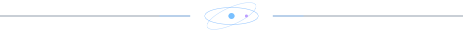
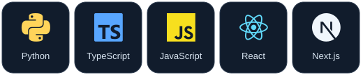
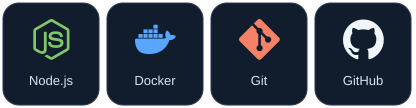
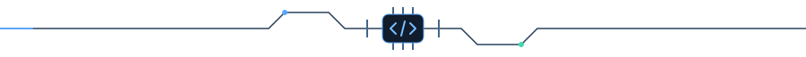

[**Explore Projects ↗**](https://github.com/Electron-S?tab=repositories) &nbsp; · &nbsp; [**Contributions ↗**](https://github.com/Electron-S?tab=overview)

## GitHub Stats

## My Toolbox

## A Little, Every Day

작은 커밋들이 모여, 다음 도구가 됩니다.

<picture>
  <source media="(prefers-color-scheme: dark)" srcset="img/snake-dark.svg">
  <source media="(prefers-color-scheme: light)" srcset="img/snake.svg">
  
</picture>

Built with curiosity. Improved through use.

